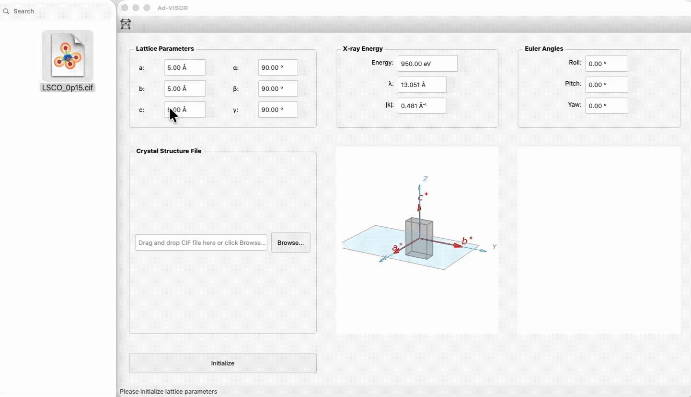
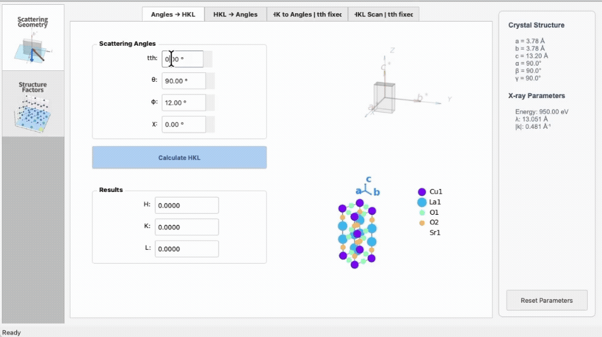
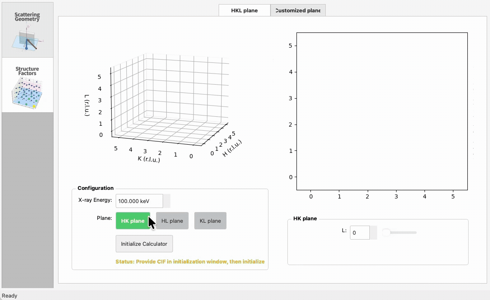

Using the App
=============
Detailed instructions for using the app are provided below. For the minimal usage, please refer to the :doc:`quickstart`.
For definitions of scattering angles, and momentum transfer HKL, see the :doc:`appendix`.

Initialization window
---------------------
- Enter lattice constants (a, b, c) and angles (α, β, γ). (Optionally) You can also drop in a CIF file to auto-fill lattice parameters and preview the unit cell.
- Enter beam energy (eV); wavelength (λ) and wave vector magnitude (|k|) update automatically.
- Euler angles (roll, pitch, yaw) update the orientation of the lattice/sample relative to the goniometer.
- Click **Initialize** to pass parameters to all tabs and open the main interface.

**Import Orientation from Diffraction Tests:**
If you have diffraction test data (known HKL values with measured angles), you can automatically determine the Euler angles:

1. Click **Import from Diffraction Test** in the Euler Angles panel.
2. Enter your diffraction measurements (H, K, L, energy, 2θ, θ, φ, χ) in the table.
3. Click **Calculate Orientation** to find the optimal Euler angles that fit your data.
4. Click **Apply and Close** to populate the roll, pitch, yaw fields.

Two deterministic (non-iterative) methods are available as the **Fit method** buttons to the right of the UB matrix:

- **Busing–Levy** (default): the first row is the *primary* reflection and is matched exactly. The second row is the *secondary* and only fixes the rotation about the first. This is the method BLISS/SPEC use, and the UB matches BLISS's after relabelling the lab axes (BLISS x = ADVISOR Y, along the beam; BLISS y = −ADVISOR X).
- **Kabsch (LSQ)**: a least-squares rotation fit over all rows.

The two methods give the same result when the measured angles agree perfectly with the lattice constants. Switching the method recalculates the current result.

**My structures (local structure library):**
ADVISOR remembers CIFs you've successfully loaded, on this device only, so you can come back to them later without finding the original file again.

- Every CIF you drop/browse and accept is saved automatically (unless you turn this off). A quiet note ("Added to My structures.") confirms it -- this never interrupts you with a pop-up.
- Click the **Structures ▾** button next to the CIF area (or **File → My structures…**) to open the picker: **Recent**, **Starred**, and **All** are views of the same saved list, with a search box that matches names, formulas, and notes.
- Selecting a row only previews it; nothing changes until you click **Use structure** (or **Use for geometry**, for a CIF with no usable atomic positions).
- Star a structure, give it your own name, or add a note -- these never change the underlying CIF data. **Remove from library** deletes only ADVISOR's saved copy; your original file on disk is never touched or modified.
- No CIF on hand yet? Use **Try an example** from the same menu to load a small, bundled, idealized structure and explore the app immediately, fully offline.
- Turning off "Remember imported CIFs on this device" (in the picker) only affects future imports -- structures already saved stay available.

----- 

Main interface
--------------
Tabs on the left host each feature. The status bar shows feedback; the toolbar includes a reset shortcut to return to init window.

1. Scattering Geometry tab
^^^^^^^^^^^^^^^^^^^^^^^^^^
This tab converts scattering angles to momentum transfer in reciprocal space and vice versa, and visualize the scattering geometry. 

**Scattering angles and momentum transfer HKL:** See the :doc:`appendix` for definitions; the tab provides visuals while you enter them.

**Functionalities**:

#. subtab **Angles → HKL**: enter scattering geometry angles (tth, θ, χ, φ), compute (H,K,L) in
   reciprocal lattice units.
#. subtab **HKL → Angles**: enter (H,K,L) in reciprocal lattice units, compute scattering geometry
   angles (tth, θ, χ, φ).
#. subtab **HK to Angles | tth fixed**: enter (H,K) and a fixed tth, compute (θ, χ, φ).
#. subtab **HKL scan | tth fixed**: enter a list of (H,K) and a fixed tth, compute (θ, χ, φ).

----

2. Structure Factor tab
^^^^^^^^^^^^^^^^^^^^^^^
Requires a CIF (from the init window) and an energy input in the tab.

#. subtab **HKL plane**: initialize, then view a 3D HKL cube with translucent planes and corresponding 2D
   slices (HK/HL/KL). Structure factors for each integer HKL are visualized in the 3D and 2D plots.
#. subtab **Customized plane**: pick arbitrary plane values and visualize structure factors on that
   slice. See the :doc:`appendix` for definitions of the plane values.

Resetting
---------

Use the toolbar button or **File → Reset Parameters** to go back to the init window, clear the CIF lock, and re-enter parameters.
